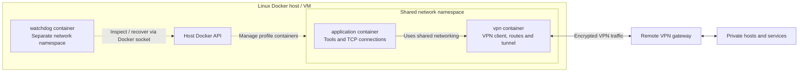
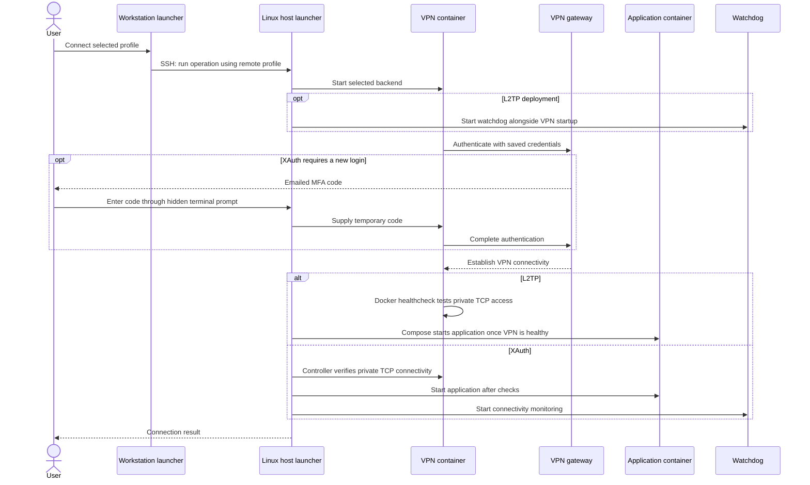
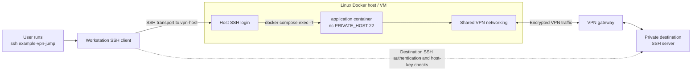
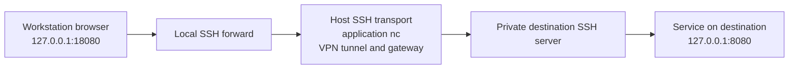

# How the VPN sidecar works

For the current managed Mac CLI, Lima VM, controller and SSH proxy path, see
[vpnmodo internals](internals.md). This page explains the underlying sidecar
concept and standalone legacy launcher architecture.

## Problem statement

Work across multiple private networks can require switching between VPN clients.
Each switch can interrupt existing connections and repeat authentication. VPN
clients on the same workstation can also compete for routes and DNS settings.

The sidecar keeps each VPN in a separate container network namespace on a Linux
host. Users select an SSH alias or service forward to reach a particular
network. This keeps VPN routing separate from the workstation's routing while
providing an explicit access path. Access still requires SSH reachability to the
Linux host and compliance with each network's authentication and access policies.

## Overview

This project lets users and tools reach private systems through a VPN client
running in Docker on a Linux host, such as a dedicated VM. The workstation
reaches that host over SSH; the VPN connects the host's container workload to
the remote private network.

The **sidecar concept** separates VPN connectivity from the application that
uses it. One container manages authentication, encryption and tunnel networking.
A second container runs alongside it and shares its network namespace, so it
can use the VPN without implementing a VPN client itself.

For the profile-managed IPsec backends, a third container watches connectivity.
Each profile selects one backend and has its own containers, settings and runtime
state. Consumer projects own the profiles and private credentials; this
repository supplies the reusable components.

Users establish the VPN session, then explicitly send SSH or service traffic
through it. Starting the sidecar does not route every workstation connection
through the VPN. The examples below assume an existing deployment; use the
[deployment guide](deployment.md) to provision one.

## Supported VPN connections

The two profile-managed backends correspond to these familiar client setups:

| Backend | Familiar client setup | Authentication in this project |
| --- | --- | --- |
| **L2TP/IPsec** | The same VPN protocol used by the macOS built-in **L2TP over IPsec** client. | Shared secret (PSK), username and password. |
| **IPsec/XAuth with MFA** | A **Fortinet FortiClient-style IKEv1 IPsec/XAuth** connection using the supported emailed-code MFA flow. | PSK and username/password, plus an emailed MFA code entered through the hidden terminal prompt for a new login. |

These are protocol and authentication mappings. The sidecar runs strongSwan
rather than the macOS or FortiClient applications. Gateway settings, IKE/ESP
proposals and the MFA exchange must match the selected backend. The XAuth
backend covers the documented emailed-code flow; it does not establish support
for every FortiClient VPN mode or MFA method, such as SSL VPN or IKEv2/EAP.

Protocol references: [Apple's L2TP settings](https://support.apple.com/guide/deployment/l2tp-settings-dep73d1b38bc/1/web/1.0)
and [Fortinet's IPsec connection settings](https://docs2.fortinet.com/document/forticlient/7.4.0/administration-guide/494391/configuring-an-ipsec-vpn-connection).
Implementation details: [L2TP/IPsec backend](../containers/l2tp-ipsec/README.md)
and [IPsec/XAuth backend](../containers/ipsec-xauth/README.md).

## 1. The sidecar: two containers, one network namespace



The Compose setting that makes this work is:

```yaml
application:
  network_mode: service:vpn
```

The application uses the VPN container's network interfaces, routes and
loopback interface. The two containers still have separate processes and
filesystems. For example, sharing networking does not automatically share DNS
configuration files. The L2TP sample explicitly points the application's
resolver at the DNS proxy in the shared namespace.

The bundled `application` service is a lightweight Alpine container kept running
so commands such as `nc` can execute inside the VPN network namespace. It is
the place where the SSH proxy opens a TCP connection to a private destination.
When adapting the Compose files to run another application, publish any
application ports on the `vpn` service because it owns the shared networking.

The watchdog stays outside that namespace so its Docker control path remains
available when the VPN fails. Its Docker socket access permits container
management and is part of the deployment's trust boundary.

Sources: [L2TP Compose](../containers/l2tp-ipsec/compose.yaml),
[XAuth Compose](../containers/ipsec-xauth/compose.yaml),
[watchdog design](../watchdog/README.md).

## 2. What each component does

| Component | Responsibility |
| --- | --- |
| Workstation | Runs the launcher, SSH client, Ansible or browser; holds the user's SSH keys. |
| Linux Docker host | Runs the containers and supplies the kernel networking used by the VPN. |
| `vpn` | Authenticates to the VPN gateway and establishes tunnel connectivity. |
| `application` | Shares VPN networking and opens connections to private destinations. |
| `watchdog` | Checks IPsec connectivity and recovers L2TP or reports XAuth failures. |
| VPN gateway | Authenticates the VPN client and provides access to the private network. |
| Private destination | Runs the requested SSH server or other service and applies its own authentication. |

The profile launcher, [`scripts/vpn`](../scripts/vpn), reads non-secret settings
from the consumer's `profiles/<name>/profile.env`. If the profile specifies a
remote SSH host, it delegates the selected operation to the launcher on that
host. Source, profiles and credentials must already be provisioned there; the
launcher does not upload them.

The resolved runtime manifest lives at `instances/<name>/compose.yaml` beside
the consumer's profile directory. It gives the launcher, SSH integration and
watchdog a common description of the deployed services. See the
[profile reference](profiles.md) for paths and supported settings.

## 3. Establishing the VPN session

VPN authentication and destination SSH authentication are separate steps.
The first establishes network access; the second logs the user into a private
machine.



This diagram shows a remote connection that needs a new session. A healthy
existing XAuth session is reused. With `--local`, the launcher runs directly on
the Linux Docker host and omits the workstation-to-host SSH delegation.

| Backend | How it connects | Recovery and scope |
| --- | --- | --- |
| L2TP/IPsec | strongSwan authenticates IPsec with the PSK; L2TP carries PPP, which authenticates with username/password. | Shared watchdog performs automatic recovery. The backend includes an IPv4 kill switch and disables IPv6 in the shared namespace. |
| IPsec/XAuth | strongSwan uses IKEv1 PSK/XAuth and an emailed MFA code for a new login. | Watchdog reports failures; fresh MFA requires interactive reconnection. This backend has no post-disconnection kill switch. |

See the backend guides for [L2TP/IPsec](../containers/l2tp-ipsec/README.md) and
[IPsec/XAuth](../containers/ipsec-xauth/README.md). The rest of this document
describes the profile-managed IPsec workflow.

## 4. How a user reaches a private machine

After connecting the VPN, the user runs an ordinary workstation SSH command.
The consumer's SSH configuration supplies a `ProxyCommand` that carries its
connection through the application container.



There are two SSH logins: the outer SSH connection authenticates to the Linux
host, and the destination SSH session authenticates to the private machine.
The workstation keeps the SSH keys and verifies both hosts. The application's
`nc` process only relays bytes; it needs neither copied SSH private keys nor an
SSH server or agent forwarding.

During one-time setup, configure the consumer's SSH aliases using
[`examples/ssh_config.example`](../examples/ssh_config.example). Include that
file from `~/.ssh/config` so the nested SSH command also resolves `vpn-host`.

After setup, run these two steps on the workstation. Use the paths, profile
name and private-machine SSH alias supplied for your project.

1. **Connect the VPN:**

   ```sh
   bash /absolute/path/to/l2tp-ipsec-vpn-sidecar/scripts/vpn \
     --profiles-dir /absolute/path/to/consumer-project/vpn/profiles example connect
   ```

   Enter the emailed MFA code if prompted.

2. **Open a terminal on the private machine:**

   ```sh
   ssh example-vpn-jump
   ```

All paths, aliases and addresses in these examples are placeholders. The Linux
host account needs the noninteractive sudo access required by the Docker
commands. Verify new SSH host keys through a trusted source before connecting;
the example's `BatchMode yes` requires a trusted destination key already.

The same destination alias works with `scp` and `sftp`. Ansible can use the
consumer's SSH integration for private hosts. L2TP health checks and XAuth
controller/watchdog TCP probes test reachability to the configured endpoint.
XAuth's Docker health check alone only checks for an ESP policy. An authenticated
destination command verifies the user's actual access.

See [private service access](remote-services.md) for the full `ProxyCommand`,
configuration details and first-use host-key verification.

## 5. How a user opens a private web service

SSH local forwarding brings a specific private service to the workstation.
For a service listening on the private SSH destination's `127.0.0.1:8080`, run:

```sh
ssh -N -T -o ExitOnForwardFailure=yes \
  -L 127.0.0.1:18080:127.0.0.1:8080 example-vpn-jump
```

Keep that terminal running and open `http://127.0.0.1:18080/` in the workstation
browser. The request follows this path:



The final HTTP connection originates at the private SSH destination. The
forward's remote `127.0.0.1` refers to that destination, while the local
`127.0.0.1:18080` listener belongs to the workstation. To reach another private
host, change the forwarding destination to an address reachable from the
private SSH server. That server must allow TCP forwarding.

For multiple managed service forwards, see
[`scripts/vpn-services`](../scripts/vpn-services) and the consumer-owned
[`services.json` example](../examples/services.json).

## 6. Health, recovery and disconnecting

The watchdog checks container health and private TCP reachability. L2TP uses
automatic recovery with a cooldown; XAuth reports that manual reconnection is
required because it cannot provide fresh MFA. Watchdog status changes appear
in Docker logs. See the [watchdog guide](../watchdog/README.md) for its recovery
sequence and settings.

Use the same explicit profile directory to inspect or disconnect a session:

```sh
bash /absolute/path/to/l2tp-ipsec-vpn-sidecar/scripts/vpn \
  --profiles-dir /absolute/path/to/consumer-project/vpn/profiles example status

bash /absolute/path/to/l2tp-ipsec-vpn-sidecar/scripts/vpn \
  --profiles-dir /absolute/path/to/consumer-project/vpn/profiles example disconnect
```

Disconnect removes the profile's VPN, application and watchdog containers and
network. Credentials and persistent watchdog state remain for the next
connection. Workstation SSH forwards can be closed with Ctrl-C.

For setup, credential placement and updates, continue with the
[deployment guide](deployment.md). For profile fields and runtime layout, use
the [profile reference](profiles.md).
