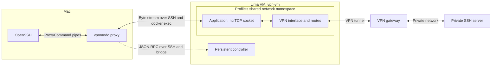

# How vpnmodo reaches a private server

This document explains the managed path: the Mac CLI, the single Lima VM
`vpn-vm`, its controller, and the containers carrying VPN traffic. For installation
and everyday commands, start with the [README](../README.md).

## The components

| Component | Responsibility |
| --- | --- |
| Mac OpenSSH client | Reads `~/.ssh/config`, authenticates to the private server and encrypts that SSH session |
| Mac `vpnmodo` CLI | Finds the saved profile reference, sends controller requests and supplies the proxy byte stream |
| Lima VM `vpn-vm` | Runs Linux and Docker; Lima provides the Mac-to-VM SSH configuration |
| `vpnmodo-controller` container | Stores profiles and credentials, manages connection operations and checks runtime health |
| VPN container for a profile | Runs the selected VPN client and configures its tunnel, routes, DNS and traffic enforcement |
| Application container for a profile | Shares the VPN container's network namespace and opens destination TCP connections |

The controller is a persistent Go service. Short-lived bridge processes relay
requests to it. Closing an RPC session does not stop a connection operation.
The controller supervises the VPN and coordinates application attachment and recovery.



The dotted path selects a healthy container. The solid path carries the
private SSH session; its bytes do not pass through the controller service.
The VPN tunnel terminates at the configured gateway, which provides access to
the private server. Starting the VPN does not make the Mac route all of its
traffic through it.

## What the proxy arguments mean

For example, the Mac's SSH configuration can contain:

```sshconfig
Host private-server
    HostName 192.0.2.10
    User PRIVATE_USER
    IdentityFile ~/.ssh/id_ed25519
    IdentitiesOnly yes
    ProxyCommand /Users/YOUR_USER/.local/bin/vpnmodo proxy work %h %p
    StrictHostKeyChecking yes
    ForwardAgent no
```

Replace the example path, address, account and identity for your environment.
The [README](../README.md#access-a-private-ssh-server) covers host-key enrollment.

When the user runs `ssh private-server`, OpenSSH substitutes `HostName` for `%h`
and the destination port for `%p` (22 by default). It launches the equivalent of:

```sh
/Users/YOUR_USER/.local/bin/vpnmodo proxy work 192.0.2.10 22
```

`work` is a literal VPN profile alias; SSH does not expand it. It is the name
registered by `vpnmodo profile create work --file work.json`. The CLI looks up
that saved reference to find the controller profile on `vpn-vm`.

These names have different jobs:

| Value | Meaning |
| --- | --- |
| `private-server` | SSH alias used by the person running `ssh` |
| `work` | VPN profile whose connected network carries the traffic |
| `192.0.2.10` | Destination inside the private network, taken from `HostName` |
| `22` | Destination SSH port, taken from `Port` or its default |

The original VPN JSON is imported when creating or updating the profile. A proxy
invocation uses the saved reference and controller state; it does not reread
that JSON or ask for its credentials.

## How the CLI asks the controller

The CLI opens an SSH connection using Lima's generated `ssh.config`. Inside the
VM, the managed setup uses `sudo -n` to run this bridge command:

```sh
docker --host unix:///var/run/docker.sock exec -i vpnmodo-controller \
    /usr/local/bin/vpnmodo-controller bridge
```

The bridge connects to `/run/vpnmodo/controller.sock` inside the controller
container. It relays JSON-RPC 2.0 messages through SSH stdin/stdout. The controller
has no HTTP API port exposed for this communication.

Each message is one JSON object followed by a newline. The examples below are
formatted across lines for readability. The client first negotiates the
application API version with `system.hello`:

```json
{
  "jsonrpc": "2.0",
  "id": 1,
  "method": "system.hello",
  "params": {"api": {"major": 1, "minor": 0}}
}
```

After the handshake, it asks for the profile's application container:

```json
{
  "jsonrpc": "2.0",
  "id": 2,
  "method": "connection.application",
  "params": {"profile": "work"}
}
```

The controller compares the saved deployment with Docker labels, profile
revision and image IDs. It checks that the application is running in the VPN
container's network namespace. It returns a container ID only
when the profile is intended to be connected, the managed deployment and
application are healthy, the VPN tunnel checks pass, and the configured private
health endpoint is reachable. An active connection operation can make the
request return busy. This inspection does not initiate a VPN login or repair.

A successful response looks like this; the repeated `a` is a synthetic
64-character Docker container ID:

```json
{
  "jsonrpc": "2.0",
  "id": 2,
  "result": {
    "container_id": "aaaaaaaaaaaaaaaaaaaaaaaaaaaaaaaaaaaaaaaaaaaaaaaaaaaaaaaaaaaaaaaa"
  }
}
```

If a usable application is unavailable, the request returns an error instead.
The CLI closes this lookup session before opening the traffic stream.

## How the traffic stream opens

The CLI opens a second SSH session to the same VM and runs its embedded Python
proxy helper there. The controller RPC handler itself is compiled Go. The CLI sends the profile, destination host/port and selected container ID in
a JSON header on stdin. The helper validates the header and asks the controller
again for the healthy application. It requires the returned ID to match the one
selected by the CLI, so a replaced or unhealthy container cannot silently take
over the connection during setup.

After validation, the helper replaces itself with the equivalent of:

```text
docker --host unix:///var/run/docker.sock exec -i CONTAINER_ID nc HOST PORT
```

`nc` opens the destination TCP socket from inside the application container.
Docker configures that container with `network_mode: service:vpn`, so it shares
the VPN container's interfaces, routes and traffic enforcement. Its generated
resolver configuration is mounted separately. The socket therefore uses the
profile's VPN network.

The CLI relays the SSH client's bytes through the command's stdin/stdout.
OpenSSH on the Mac performs the private server's SSH handshake, host-key checks
and user authentication over this stream. Destination private keys stay on the
Mac; this path does not copy them into the VM or forward an SSH agent.

Lima's generated SSH configuration supplies the current VM connection details.
Neither the destination SSH configuration nor the profile alias needs a fixed
VM IP, VM SSH port or Docker container ID.

## Connection and health boundaries

Run `vpnmodo up work` before using the proxy. Connection establishment and any
XAuth MFA belong to that operation. `proxy` attaches to an existing healthy
application; it does not reconnect the VPN or prompt for MFA. A missing profile,
disconnected VPN or failed health check prevents the proxy from opening.

The checks prove different things:

| Check | What it proves |
| --- | --- |
| Setup readiness | The controller is ready, its expected version is running, and Docker/runtime access is available |
| `connection.application` | The profile has a currently usable application, VPN tunnel and configured private health endpoint |
| `ssh private-server hostname` | That particular private SSH server is reachable and destination SSH authentication succeeds |

A healthy configured endpoint does not establish that every private destination
or application login will work. Existing proxy streams are not automatically
moved to a replacement container. Each new proxy process performs the lookup
and recheck at attachment, not per packet. OpenSSH connections or channels that
reuse an existing ControlMaster also reuse its established proxy stream.

## Where the names and credentials live

On the Mac, the default configuration directory is
`~/Library/Application Support/vpnmodo/`:

- `hosts.json` records the managed VM and its Lima SSH configuration path.
- `hosts.json.profiles.json` maps local aliases such as `work` to their controller
  profiles on that VM. It contains references, not VPN credentials.
- `setup/vpn-vm/` caches provisioning assets and registry authentication used by
  setup. Registry access is separate from the VPN's credentials.

On the VM, the managed controller stores its persistent state under
`/root/.local/share/vpnmodo/controller-state/`. Profile metadata and credentials
are stored separately; operations and deployment records also persist there.
The user-supplied VPN JSON remains a separate file on the Mac and can contain
all the credentials needed to import that profile. XAuth MFA is supplied for
the current connection challenge rather than saved in the profile.

For more detail, see [profile storage](design/002-profile-storage.md),
[persistent operations and MFA](design/003-persistent-operations.md), and
[service access and forwarding](design/007-service-access.md).

## Implementation entry points

| Code | Responsibility |
| --- | --- |
| [CLI proxy](../cmd/vpnmodo/proxy.go) | Resolve the reference and request `connection.application` |
| [SSH transport](../internal/host/ssh.go) | Start the bridge and connect the JSON-RPC client |
| [Controller dispatcher](../internal/controller/server.go) | Handle the RPC method and return the selected container ID |
| [Runtime inspection](../internal/lifecycle/access.go) | Gate access on connection intent and current health |
| [Managed deployment](../internal/managedvpn/adapter.go) | Inspect the profile's owned containers and tunnel |
| [Proxy transport](../internal/host/proxy.go) and [VM helper](../internal/host/proxy.py) | Revalidate the application and relay the destination byte stream |
| [Container manifest](../internal/managedvpn/manifest.go) | Configure the shared VPN/application network namespace |
